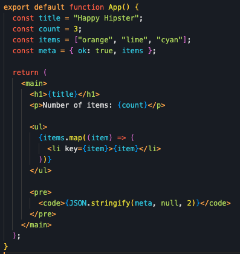

# Happy Hipster

Custom VS Code theme created from your provided palette.

## Included Theme

- `Happy Hipster`
- Semantic highlighting is enabled (`semanticHighlighting: true`) with custom `semanticTokenColors` for broader language coverage.

## Preview

## Local Run (Development Host)

1. Open this folder in VS Code.
2. Press `F5` to launch Extension Development Host.
3. In the new VS Code window, run:
   - `Preferences: Color Theme`
   - select `Happy Hipster`.

## Files

- `package.json` - extension manifest and theme registration.
- `themes/happy-hipster-color-theme.json` - full color theme definition.
- `PUBLISHING.md` - release and Marketplace publishing steps.
